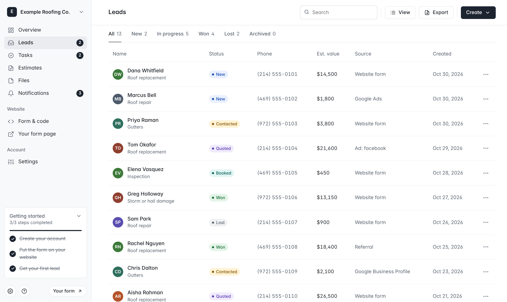
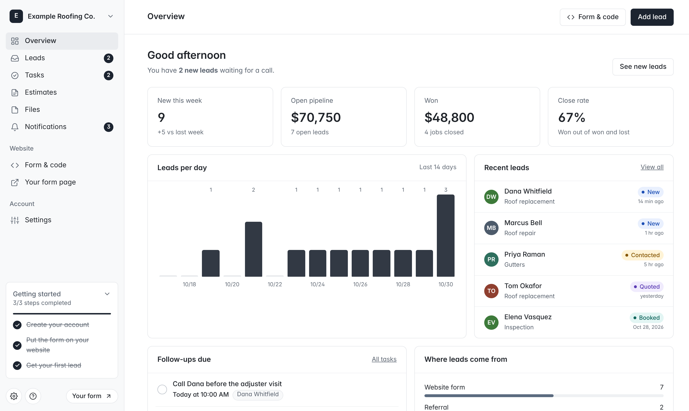
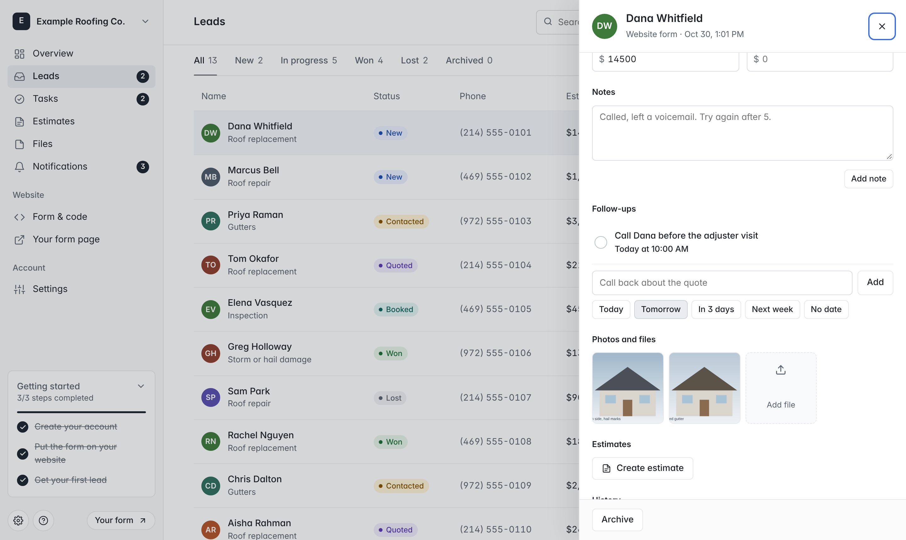
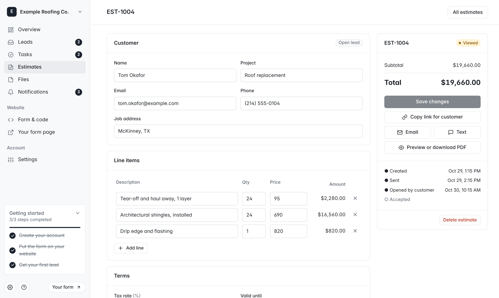
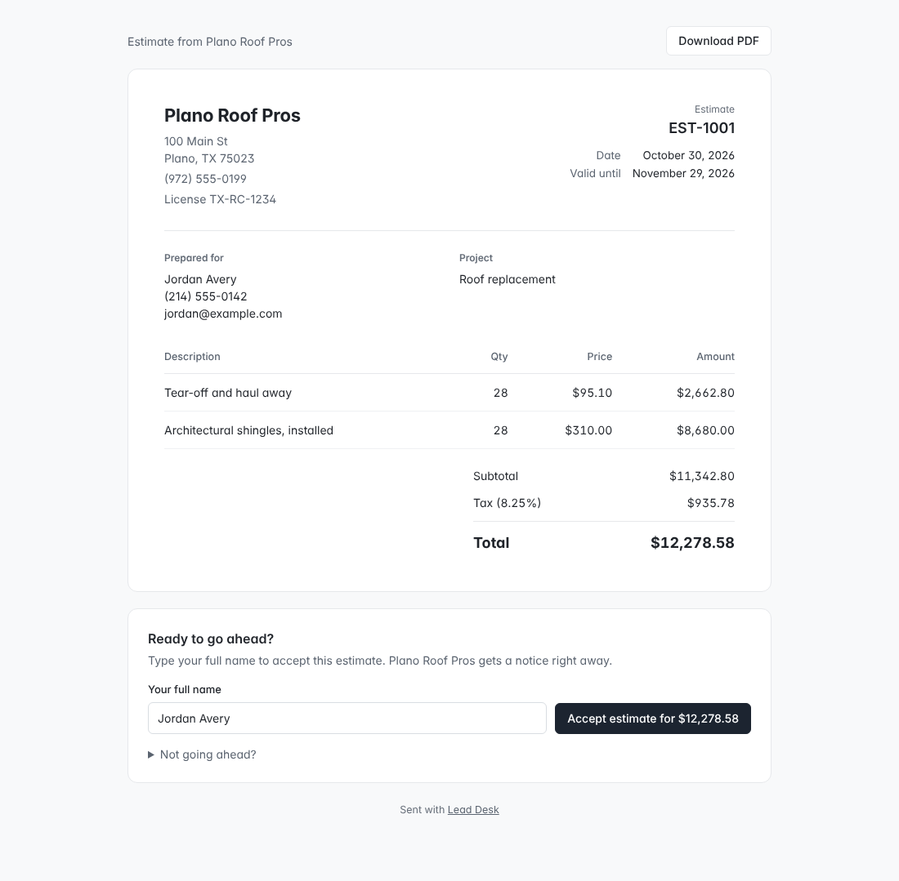

# Lead Desk

A free estimate form for contractors' websites, and a clean dashboard to call back, quote and win every lead.

**[Use it free at leaddesk-app.netlify.app](https://leaddesk-app.netlify.app)**, or click around the **[live demo](https://leaddesk-app.netlify.app/demo/)** first.



Contractors create an account, style their form, paste two lines of code on their website, and every request shows up in their own private lead list. One hosted Lead Desk serves every account. The code is open source under the MIT license.

## What a contractor gets

- **A website form in two lines of code.** Works on WordPress, Wix, Squarespace, Webflow, Shopify and plain HTML. The heading, services, phone number and button color are set in the dashboard, and the website updates by itself.
- **A form page link** (`/f/?k=...`) for contractors without a website: Google Business Profile, Instagram bio, texts.
- **A lead dashboard.** Overview with weekly numbers and pipeline value, a list and a drag-and-drop board, a detail panel with one-tap call and email, notes, estimate and final price, full history, archive and delete forever, CSV export.
- **Customer photos.** Visitors can add up to 3 photos to the form. They are shrunk on the phone before sending and saved with the lead.
- **Tasks.** Follow-ups with a date, from a lead or on their own. Overview shows what is due today, and the menu shows how many are due.
- **Estimates.** Line items, tax and an expiry date. The customer gets a private link to view, download as PDF, and accept by typing their name, or decline. An accepted estimate marks the lead won with the final price.
- **Files.** Attach PDFs, measurements or contracts to a lead (up to 4 MB each, 250 MB per account). Every photo and file in one place.
- **Notifications.** New leads, follow-ups that are due, and customers opening, accepting or declining estimates.
- **Alerts** to Slack, Discord, Zapier or Make through a webhook, including accepted estimates.
- **Spam protection**: a hidden trap field, a "filled in too fast" check, 8 leads per visitor per hour per contractor, and 120 per contractor per hour.
- **Security**: passwords hashed with scrypt, signed httpOnly session cookies, other websites cannot call the dashboard API, optional list of websites allowed to send leads, form key rotation, password change signs out other devices, account deletion removes every lead.

## Screenshots

| Overview | Lead detail |
| --- | --- |
|  |  |
| **Estimate editor** | **What the customer sees** |
|  |  |

## How it is built

```
app/                      what Netlify serves
  index.html              landing page
  auth/index.html         sign in and sign up (/login, /signup)
  dashboard/index.html    the dashboard (one file, no build step)
  demo/index.html         the dashboard on sample data (generated)
  f/index.html            hosted form page
  e/index.html            estimate page the customer opens from their link
  leaddesk.js             the embeddable form (no dependencies, Shadow DOM)
  assets/ui.css           shared styles
  privacy/, terms/        policy pages
netlify/functions/
  auth.mjs                /api/auth/*  signup, login, logout, me
  app.mjs                 /api/app/*   leads and settings for the signed-in account
  lead.mjs                /api/lead and /api/form/<key>, called by contractors' websites
  estimate.mjs            /api/estimate/<token>, the customer's view, accept and decline
netlify/lib/store.mjs     storage, accounts, sessions, files, rate limits
netlify/lib/estimate.mjs  estimate totals, added up in cents
tests/                    backend tests and a local dev server
docs/                     screenshots for this page
```

Data is stored in [Netlify Blobs](https://docs.netlify.com/blobs/overview/). Each lead is saved under its account id, and every dashboard call is scoped to the account in the session cookie.

## Run your own copy

1. Fork this repository and import it in Netlify (**Add new site > Import an existing project**). No build settings are needed.
2. Optional: set `SESSION_SECRET` (32 or more random characters) in **Site configuration > Environment variables**. Without it, Lead Desk makes one on first use and keeps it in storage.
3. Open the site and create the first account.

## Develop

Needs Node 18 or newer.

```bash
npm test                      # backend tests, no network
npm run dev                   # site on :8888, fake contractor website on :8889
node scripts/build-demo.mjs   # after editing app/dashboard/index.html
```

`npm run dev` keeps data in memory. To test the form from another website, copy your key from Form & code and open `http://localhost:8889/tests/fixtures/host.html?key=YOUR_KEY`.

## Not yet included

- Password reset by email, and sending estimates by email from Lead Desk itself (both need an email provider). Today the Email and Text buttons open the contractor's own mail or messages app with the link filled in.
- Team members on one account.
- Changing the sign-in email.

## License

MIT. See [LICENSE](LICENSE). Not affiliated with Netlify.
